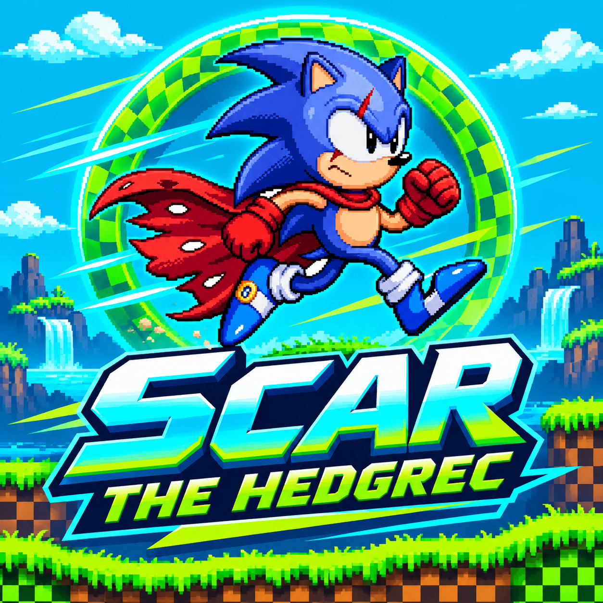

# Scar the Hedgerec 🦔⚡



**Scar the Hedgerec** is a high-speed 16-bit retro platformer built on an authentic 360-degree fixed-point physics engine. Designed as a clean, cross-platform (**Windows, Linux, macOS, and Termux / Android**) HTML5 Canvas & JavaScript game with zero external runtime dependencies required.

📱 **[Download Android APK v0.0.3](https://github.com/Protoevaneglium/Scar-the-Hedgerec/releases/download/v0.0.3/scar-the-hedgerec-v0.0.3.apk)** — all six acts, offline, Android 8.0+. [Android build and test details](ANDROID.md).

📄 **[Read the Full Physics Specification (`SONIC_PHYSICS_SPEC.md`)](SONIC_PHYSICS_SPEC.md)**  
📐 **[Level Core Foundation Blueprint (`templates/LEVEL_CORE_BLUEPRINT.md`)](templates/LEVEL_CORE_BLUEPRINT.md)** • **[Downloadable Starter Core Kit (`.zip`)](public/downloads/scar-level-core-template.zip)** *(or open `/template.html` when running locally)*

---

## 🚀 Easy Install & Startup (Windows, Linux, macOS, Termux / Android)

Every platform uses a simple **2-step setup**:
1. Run the **First-Time Install** command once — it downloads/updates the game and automatically generates your **`scar`** (`.bat` / `.sh`) launcher.
2. **Every time after that**, just open your terminal / Command Prompt and type **`scar`**!

> **Note:** Every command box below contains **only runnable commands** (no `#` comments inside the boxes), so you can click GitHub's **Copy** icon and paste directly into Windows Command Prompt (`cmd`), PowerShell, Linux Terminal, or Termux without errors.

---

### 1. Windows 🪟 (Command Prompt `cmd` or PowerShell)

#### Step 1 — First-Time Install (Run Once)
Pick the box that matches the window you have open *(installs or updates `%USERPROFILE%\Scar-the-Hedgerec`, checks for Node.js, and creates the `scar` command)*.

**Command Prompt (`cmd`)** — no PowerShell needed:

```cmd
curl -fsSL -o "%TEMP%\scar-install.bat" https://raw.githubusercontent.com/Protoevaneglium/Scar-the-Hedgerec/master/install-windows.bat && "%TEMP%\scar-install.bat"
```

**PowerShell** (the prompt starts with `PS`) — paste exactly this, do **not** wrap it in another `powershell ...` call:

```powershell
irm https://raw.githubusercontent.com/Protoevaneglium/Scar-the-Hedgerec/master/install-windows.ps1 | iex
```

> **Got `Access is denied` or a script-execution error?** Some antivirus / security policies block launching scripts. Use the Command Prompt box above instead, or use the manual ZIP install below.

#### Step 2 — Start the Game Every Time
Whenever you open **Command Prompt** or **PowerShell** in any folder, simply type:

```cmd
scar
```

*(You can also type `scar.bat` or `scar.cmd`, or double-click `scar.bat` in your user folder `C:\Users\<YourName>\scar.bat` or inside the `Scar-the-Hedgerec` folder. Press `Ctrl+C` in the terminal window anytime to stop the server.)*

<details>
<summary><b>Alternative: Manual Git Clone / ZIP Install on Windows</b></summary>

If you cloned or unzipped the repository manually, run this inside the `Scar-the-Hedgerec` folder once to register the global `scar` / `scar.bat` command (or simply double-click `install-windows.bat` in File Explorer):

```cmd
install-windows.bat
```

Then start the game anytime by typing:

```cmd
scar.bat
```
</details>

---

### 2. Linux & macOS 🐧🍎

#### Step 1 — First-Time Install (Run Once)
Open your **Terminal**, paste this single command, and press **Enter** *(clones or updates `~/Scar-the-Hedgerec` and generates `~/.local/bin/scar` + `~/scar.sh`)*:

```bash
curl -fsSL https://raw.githubusercontent.com/Protoevaneglium/Scar-the-Hedgerec/master/install-linux.sh | sh
```

*(If your Linux distro uses `wget` instead of `curl`, use:)*

```bash
wget -qO- https://raw.githubusercontent.com/Protoevaneglium/Scar-the-Hedgerec/master/install-linux.sh | sh
```

#### Step 2 — Start the Game Every Time
Whenever you open a new **Terminal**, simply type:

```bash
scar
```

*(To launch immediately inside the same terminal window right after first-time install without opening a new tab, run `sh ~/scar.sh`.)*

<details>
<summary><b>Alternative: Manual Git Clone Install on Linux / macOS</b></summary>

```bash
git clone https://github.com/Protoevaneglium/Scar-the-Hedgerec.git
cd Scar-the-Hedgerec
sh install-linux.sh
sh scar.sh
```
</details>

---

### 3. Termux / Android 📱

#### Step 1 — First-Time Install (Run Once)
Open **Termux**, paste this single command, and press **Enter** *(installs Node.js/Git if needed, downloads the game, and generates `$PREFIX/bin/scar` + `~/scar.bat`)*:

```bash
pkg update -y && pkg install -y curl && curl -fsSL https://raw.githubusercontent.com/Protoevaneglium/Scar-the-Hedgerec/master/install-termux.sh | sh
```

#### Step 2 — Start the Game Every Time
Whenever you open **Termux**, simply type:

```bash
scar
```

and press **Enter** — it starts the local server and opens your Android browser at `http://localhost:3000` with multi-touch D-Pad (`◀`, `▼`, `▶`) and `JUMP` controls!

---

## ✨ Key Features

- **Classic 3-Act Zone Progression, Title Cards & Lives System**:
  - **16-Bit Sliding Title Cards** on every Act (*Zone 1 Act 1 — Palmtree Panic*, *Zone 1 Act 2 — Starlight Resort*, *Zone 1 Act 3 — Boss Act with Animal Capsule*) + Act Clear Score Tally (`TIME BONUS` + `RING BONUS`) & smooth fade transitions across Acts.
  - **Classic Lives (`SCAR × 03`)**: Start with `3` lives, earn extra lives from **Scar `1-Up` TV Monitors** and every **100 Rings**, with authentic pixel **`GAME OVER`** and 10:00 **`TIME OVER`** overlays.
- **Classic Sonic Death Animation & Physics Mechanics (Acts 1 & 2)**:
  - **Authentic Death Leap**: Taking damage at `0` rings (without a shield) or falling off-screen into a pit below `deathY` triggers the classic upward death leap (`ysp = -7.0`), locks the camera in place, and bypasses terrain collision.
  - **Two-Phase Sprite Animation**: Displays the custom shocked wide-eyed pose (`death1`) during the initial rise, transitioning into the head-back screaming pose (`death2`) on descent before losing a life and respawning at the active checkpoint.
- **Level 2 — Starlight Resort (Zone 1 Act 2)**:
  - **11,400px High-Speed Layout**: Momentum-driven split paths inspired by Sonic 2's Emerald Hill Act 2 + Sonic Colors (*Starlight Carnival / Tropical Resort*):
    - **Lower Twin-Loop Expressway**: Waterfall bridges, launch crests, and twin 360° loops.
    - **Upper Starlight Coaster Highway**: 3-wave corkscrew roller-coaster skyway, 3 Upper 360° loops, and Finale Giant Ring Sky Island.
    - **2.5D / 3D Visual Infusion**: Sphere-shaded ringed planets, rotating starlight ferris wheels, cylindrical plasma waterfalls, and extruded road decks fixed to the 2D plane.
- **Zone 2 Act 1 — Marble Canopy**:
  - A 12,000px jungle and marble-ruin course inspired by Marble Zone, Angel Island, and the previously supplied maps' branching routes. Four marked wall-kick towers feed elevated highways; a continuous lower road keeps the action moving through six loops.
  - Waterfalls, floating sanctuaries, molten masonry vents, mechanical beetles, treasure balconies, and a sky that changes with progress, time, and era.
  - Original 156 BPM FM/marimba soundtrack with jungle percussion. Rebuild its seamless 74-second loop with `node scripts/compose-zone2-music.js`.
  - Reuses the earlier acts' pinball bumpers, swinging platforms, smashable walls and rocks, collapsing bridges, trap doors, and sparkling step shortcuts, alongside the core rings, monitors, springs, checkpoints and giant ring.
  - Continues after Kitt's capsule rescue, or open `http://localhost:3000/?nointro&stage=z2_act1`. Steer toward marked walls and tap Jump repeatedly to alternate kicks; ring trails show the climbs.
- **Zone 2 Act 2 — Molten Sanctuary**:
  - A 14,400px course combining purple marble lava galleries with floating ivory temples, mossy arches, and a peach cloud sea, inspired by the supplied Marble Zone and Sky Sanctuary maps.
  - Lava ignites globally after **15 seconds of active play**. A countdown and supplied Sonic CD warning effects announce ignition; hot lava then causes normal ring/shield damage on contact. Elevated skyways and basalt stepping stones provide safe crossings. Death pauses the timer; Reset restarts it.
  - Six marble slides build rolling momentum; three turquoise thermal updrafts launch Scar into looping sky routes, while rising sanctuary lifts and wall kicks offer alternate climbs.
  - The complete shared object kit includes rescuable badnik animals, rings, monitors, star posts, springs, giant ring, swinging platforms, bumpers, breakable walls/rocks/bridges, trap doors, and sparkling steps.
  - Rosie notices and waves to Scar, paces around the final temple, and follows him with room to move. Tap **Up / ▲** near her to talk; she reacts to his speed and hops along when he jumps. Her movement, planted idle/blink, greetings, and real hops use the supplied Sonic CD Amy Rose/Rosey sprite sheet. The reunion awards its bonus once and opens the final goal; conversations never lock Scar's controls. The supplied sound pack adds ignition, warning, updraft, and reunion cues; original file IDs and credits are retained in `public/assets/sfx/sonic_cd_manifest.json`.
  - Continues after Marble Canopy Act 1, or open `http://localhost:3000/?nointro&stage=z2_act2`.
- **Zone 2 Act 3 — Sanctuary Duet**:
  - Scar and Rosie face an armored crocodile and crawfish on a floating island of purple marble, moss and ivory sanctuary columns. A short staging route keeps the shared rings, monitors, loop, spring, moving platform, checkpoint, giant ring and animal rescues.
  - Scar says **“Alright!”** when the fight begins. The crocodile telegraphs musical-note volleys; the crawfish launches claws that return across the arena. Rosie follows, dodges and physically approaches recovering enemies to crack their shells.
  - Press **C / controller X** or **Call Rosie** for a tag assist. An opened shell permits one spinning hit before sealing again; holding a bounce or invincibility cannot bypass armor. Rosie also assists automatically. Both enemies must fall before the animal capsule unlocks, and a death retries the encounter at its checkpoint.
  - Boss animation and projectile crops come from the supplied Vector and Crush Crawfish sheets, with complete source sheets, credit headers and crop records under `public/assets/duo_boss_sources`. After victory Rosie returns to her existing conversation and hug behavior.
  - Continues after Molten Sanctuary Act 2, or open `http://localhost:3000/?nointro&stage=z2_act3`.
- **Custom Character Rig & Advanced High-Speed Techniques**:
  - **Scar the Hedgerec**: Full 7-frame sprite rig (`idle`, `walk1`, `walk2`, `run1`, `run2`, `death1`, `death2`) + Spin Dash ball.
  - **Sonic CD Super Peel-Out (`↑ + Jump`)**: Rev Figure-8 legs in place with cyan/magenta vortex particles, launching uncurled at supersonic speed (`12.0`).
  - **Mid-Air Drop Dash**: Hold jump in mid-air to charge an electric cyan/gold halo for an instant high-speed rolling dash on landing.
  - **Super Speed Shoes & Boost Smash**: Doubles top speed (`12.0`) and acceleration with trailing neon afterimages, busting straight through Badniks on contact.
  - **Sonic Colors Starlight Dash Rings**: Dual-rim glowing aerial hoops that rocket Scar along angled trajectories.
- **Expanded Badnik Rosters across Acts 1 & 2**:
  - **Act 1 Badniks**: Motobug, Crabmeat, Buzz Bomber, Spikes (Yadorin), Caterkiller, Burrobot, Batbrain, and Chopper.
  - **Act 2 Sonic 2 Badniks (14 Species, 29 Enemies)**: Masher (waterfall leaps), Buzzer (targeting stingers), Coconuts (palm tree windup), Sping, Grounder, Crawl (star bumper thrust), Shellcracker, Slicer, Balkiry, Nebula, Octus, Chop, Turtloid, and Asteron.
- **Classic Sonic Common Objects**: Animated **Rings & Ring Sparkles**, **Item Monitors** (*Blue Shield*, *Invincibility*, *Super Ring +10*, *Speed Shoes*, *Scar 1-Up*), **Checkpoint Star Posts**, **Red & Yellow Springs**, **Spikes**, **Giant Ring (Okina Ring)**, spinning **Robotnik / Sonic Goal Post**, and **Act 3 Boss Animal Capsule**.
- **Animal rescues in every campaign act**: Badniks free animated animals in Zone 1 Acts 1–3 and Zone 2 Acts 1–2. Act 3 also keeps its boss capsule rescue. Animals hop on the real terrain and use the shared animal sprite sheet; stage resets restore the encounters.
- **Authentic Audio**: Looping soundtrack (`level1.mp3`) + custom WAV and synthesized retro sound effects (Jump, Rings, Goal Post, Peel-Out, Drop Dash, Dash Rings, Death Sting, 1-Up, and Tally).
- **Exact 16-Bit Fixed-Point Physics (`60 FPS` Sub-stepped)**:
  - Six analytical raycast sensors (**A/B** Ground, **C/D** Ceiling, **E/F** Wall Push) across Floor (`Mode 0`), Right Wall (`Mode 1`), Ceiling (`Mode 2`), and Left Wall (`Mode 3`), with 360° loop traversal on multiple layers.

---

## 🧪 Run the Automated Verification Suite

```bash
npm test
```

For a complete rebuilt baseline with reproducible adversarial checks and a source fingerprint, run `npm run verify:baseline -- --stress`. See [TESTING.md](TESTING.md) for coverage, seeds, reports, and the manual playtest pass.

Image-tool development uses Node.js 20.9+ and `npm ci`. This installs the optional image-processing dependency and enables the image fixture tests. The game launcher and core verification suite still work without developer dependencies on Node.js 18+.

---

## 🎮 Controls (Keyboard & Android Touch)

**Zone 1 Act 3 — Kitt Bazooka:** Take the canyon speed route or climb the fortress's stacked upper routes. Tap **Jump while touching a marked climb wall** to kick away; hold toward a wall to slide. Spring launches, ring trails, and elevated bridges lead toward the citadel. The sky changes as you approach it, and **T** still cycles the time eras. In the arena, jump-spin into Kitt or return his missiles while curled. Ten collectible rings appear around Kitt and near the arena edges; collected rings respawn after seven seconds while the battle continues. Watch the warning target, exploit his reload, and open the animal capsule after his eight-hit defeat.

The Act 3 layout takes inspiration from the supplied **Emerald Hill Act 2** and **Carnival Night Act 1** maps; its orange canyon, violet fortress, and cat insignia come from the supplied Kitt artwork. The transparent boss poses and fortress panorama were adapted with the built-in image generation tool; the exact prompts are saved in [`public/assets/kitt_art_prompts.json`](public/assets/kitt_art_prompts.json).

Regular campaign enemies use the supplied Sonic 1 and Sonic 2 Badnik sprite sheets, including Marble Canopy's enemies. Both original sheets, with their credit headers intact, are preserved in [`public/assets/enemy_sources`](public/assets/enemy_sources). The [crop manifest](public/assets/enemy_sources/manifest.json) records the source rectangle and pixel hash for every one of the 77 animation frames. Packing only removes the documented sheet background colors; rendering uses nearest-neighbor scaling and the established display sizes and anchors. Species are declared explicitly so reordering enemies cannot change their appearance. Kitt remains the custom cat boss described above.

After installing development dependencies, `npm run build:enemy-atlases` rebuilds the packed enemy images from those sources. The dependency-free provenance and rendering checks in `npm test` verify the native pixels and every campaign roster; the starter kit includes the original sheets, manifest and both atlases.

Design research: [SEGA's Superstars manual](https://manual.sega.jp/sonicsuperstars/en/index.html) describes multiple routes and zone-specific loops, springs, and other contraptions. [Hirokazu Yasuhara's design interview](https://www.gamedeveloper.com/design/game-design-psychology-the-full-hirokazu-yasuhara-interview) discusses visible intermediate goals, player control, and planning layered layouts in three dimensions. Here those ideas inform the visible upper viaducts, spring-to-climb connections, speed-fed loops, and lower recovery road.

| Input | Action |
| :--- | :--- |
| **Left / Right Arrows**, **A / D**, or Touch **◀ / ▶** | Run / Steer / Decelerate |
| **Up Arrow**, **W**, or Touch **▲** | Look Up (when stopped) |
| **Up (▲)** + **Space / Z / X / C / JUMP** | Super Peel-Out (Hold Up + Jump to rev, release Up to launch) |
| **Down Arrow**, **S**, or Touch **▼** | Crouch (when stopped) or Roll (when `\|gsp\| >= 1.0`) |
| **Down (▼)** + **Space / Z / X / C / JUMP** | Charge Spin Dash (Release **Down** to launch) |
| **Mid-Air Hold JUMP** | Charge Mid-Air Drop Dash (hold while airborne to blast forward on landing) |
| **Space / Z / X / C** or Touch **JUMP** | Jump (Release early for short hop; fast-forwards Act Clear tally) |
| **C** near Rosie, or **Talk to Rosie** | Open / leave a branching conversation; **1 / 2 / 3** or click a reply to answer; **Esc** leaves. C remains Jump away from Rosie. |
| **1 – 7** (or Top-Bar **Checkpoint** button) | Warp to Stage Checkpoints |
| **T** (or Top-Bar **Time** button) | Cycle Time Era (*Good Future* / *Present* / *Past*) |
| **M** (or Top-Bar **Stage** button) | Switch Stage (*Zone 1 Act 1*, *Act 2*, *Act 3 Boss*, *Zone 2 Act 1*, *Physics Test*) |
| **Tab** or **G** | Toggle Debug HUD & Sensor Raycast Overlay |
| **R** | Reset Stage & Objects (or Restart on Game Over) |
| **P / Esc** (or Top-Bar **Pause**) | Pause / resume; Esc closes Rosie dialogue first. |

Xbox controllers work through the browser's [standard Gamepad API mapping](https://w3c.github.io/gamepad/#remapping). Connect by USB or Bluetooth, focus the game and press a controller button to let the browser detect it. Release the controls once, then use A or Menu to start. The game shows “Controller ready” when armed. Reconnecting or returning to the game requires a neutral stick and released buttons before a new action.

| Xbox input | Action |
| :--- | :--- |
| **Left stick / D-pad** | Move, look up, crouch / roll |
| **A** | Jump; hold for drop dash; continue results / game over |
| **Down + A** | Charge spin dash; release Down to launch |
| **Up + A** | Charge peel-out; release Up to launch |
| **X** near Rosie | Open / leave a conversation |
| **Up / Down**, then **A** in conversation | Select / confirm a reply |
| **B** in conversation | Leave the conversation |
| **Menu** | Pause / resume; A or B also resumes from pause |

Keyboard, touch and controller inputs can be mixed. Controller disconnects release controller input without releasing a held keyboard or touch control. Pause freezes gameplay, deaths, results and Rosie animations; releasing the resume button prevents it from becoming a jump. The downloadable starter includes the same controller support.

In Molten Sanctuary, Rosie can approach and briefly hug Scar when he stands nearby facing away. Hearts rise from her head, and moving, turning or jumping ends the hug. Her local conversation library contains 35 branching exchanges about the ruins, routes, rings and future adventures. She remembers choices during the act, including whether Scar welcomes hugs, prefers to be asked, or wants space. Death closes the conversation while preserving those preferences; restarting the act begins fresh.

Scar uses the supplied Sonic CD voice recordings: hugs alternate “Yes!” and “Yeah!”, extra lives use “Yes!”, act completion uses “Alright!”, and Super Peel-Out launches use “I'm outta here!”. Speech shares one voice channel with a short cooldown; hug replies take priority. Audio OFF stops speech with the other sounds. Original PCM filenames and hashes are recorded in `public/assets/sfx/sonic_cd_manifest.json`, with the phrase mapping checked against the [original sound-test PCM table](https://github.com/sonicretro/scddisasm/blob/main/src/Title%20Screen/Secrets/Sound%20Test.asm).
